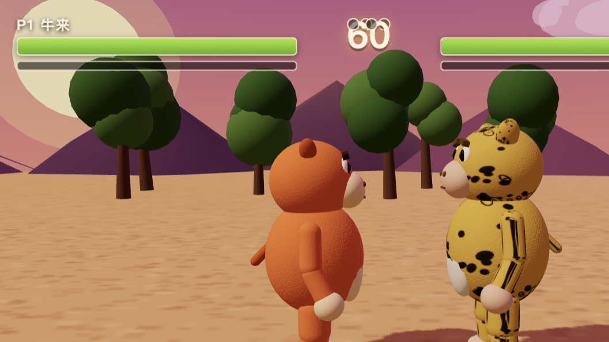

# 牛来格斗 · niulai

基于 Three.js 和 Node.js 的浏览器 3D 格斗游戏，支持本地双人对战、人机练习与局域网联机。

本仓库由 [liyupi/niulai-game](https://github.com/liyupi/niulai-game) 转存而来，保留原始代码和提交历史，由 [kakssjs](https://github.com/kakssjs) 用于后续修改与持续开发。当前转存版本仅重写本 README，游戏功能沿用上游实现。



## 游戏内容

- 7 名可选角色：牛来、豹拉、牛妈妈、牛爸爸、小绳头、云雀、头狼。
- 3 个战斗舞台：落日荒漠、暗夜狼林、云雀之森。
- 轻重拳脚、连招取消、防御、闪避和角色专属必杀技。
- 三局两胜、限时对战、连击提示、打击停顿与 KO 演出。
- 角色、场景和游戏音效通过代码程序化生成。

## 本地运行

准备 Node.js 和 npm，使用支持 WebGL 的现代桌面浏览器。

```bash
git clone https://github.com/kakssjs/niulai.git
cd niulai
npm ci
npm start
```

启动后访问 [http://localhost:3000](http://localhost:3000)。项目使用原生 JavaScript ES Modules，无需额外构建；Three.js 由本地安装的依赖提供。

局域网对战：让两台设备连接同一局域网，在浏览器中打开服务器终端打印的局域网地址，然后分别选择「局域网联机对战」。服务器会自动配对，先进入者为 P1 主机。若无法连接，请检查主机防火墙是否允许该端口访问。

默认端口为 `3000`，可通过环境变量 `PORT` 修改。此服务面向本地和局域网使用，公网部署需另行评估服务安全与网络配置。

## 键盘操作

| 动作 | 玩家 1 | 玩家 2 |
| --- | --- | --- |
| 左右移动 | A / D | ← / → |
| 跳跃 | W | ↑ |
| 防御（按住） | S | ↓ |
| 轻拳 / 重拳 | 空格 / 左 Shift | 1 / 2 |
| 轻踢 / 重踢 | E / Q | 4 / 5 |
| 必杀技（能量满） | F | 3 |
| 闪避 | 双击 A 或 D | 双击 ← 或 → |

玩家 2 的攻击键同时支持数字区与小键盘，具体映射见 `src/config.js`。

## 代码结构

| 文件 | 职责 |
| --- | --- |
| `index.html` | 页面结构、界面样式及游戏入口 |
| `server.js` | 静态文件服务、WebSocket 配对与消息中继 |
| `src/main.js` | 游戏流程、模式切换与主循环 |
| `src/characters.js` | 角色定义 |
| `src/config.js`、`src/input.js` | 游戏配置与键盘输入 |
| `src/fighter.js`、`src/moves.js`、`src/combat.js` | 角色状态、招式数据与战斗判定 |
| `src/model.js`、`src/stage.js` | 程序化角色模型与舞台 |
| `src/camera.js`、`src/fx.js`、`src/audio.js` | 相机、特效与合成音效 |
| `src/ai.js`、`src/net.js` | 人机逻辑与联机同步 |
| `src/ui.js` | 游戏界面更新 |

## 继续开发

在本仓库基础上增量修改即可：角色配置从 `src/characters.js` 入手，战斗平衡从 `src/moves.js` 入手，界面和流程分别查看 `index.html` 与 `src/main.js`。

建议每次修改后启动服务，验证相关模式和交互；涉及共享战斗逻辑时，同时回归本地、人机与联机模式。当前 `package.json` 仅提供 `start` 脚本，尚未配置自动化测试或构建脚本。

如需跟踪上游更新，可添加原仓库为远程：

```bash
git remote add upstream https://github.com/liyupi/niulai-game.git
git fetch upstream
```

拉取后先审查差异，再决定合并，避免覆盖本仓库后续修改。问题反馈与改进建议可提交到[本仓库 Issues](https://github.com/kakssjs/niulai/issues)。
